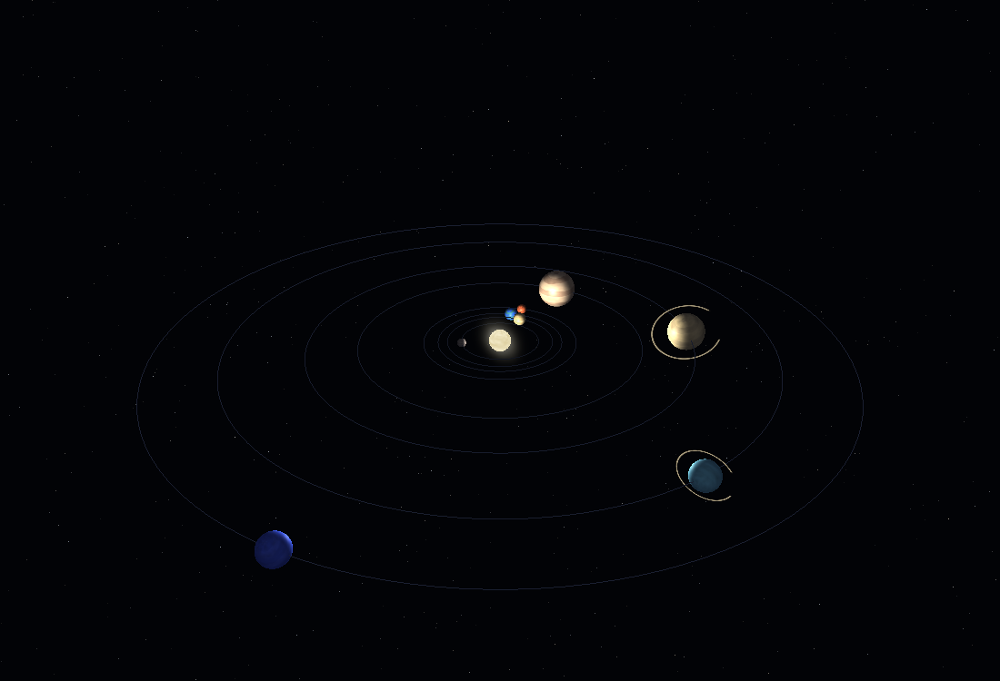
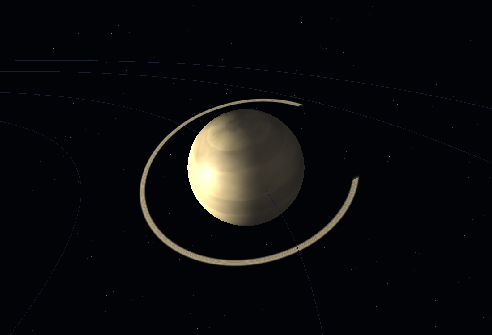

# 3D Solar System — an OpenGL graphics project

A small, self-contained OpenGL 3.3 project that shows our solar system in 3D.
The sun sits in the middle with a glowing corona, eight planets travel along
their orbits, each planet spins on its own axis and leans over at its axial
tilt, Saturn and Uranus wear their rings, and a field of stars fills the sky.

Everything is drawn with **GLSL shaders** on the modern **OpenGL 3.3 core
profile** — no legacy `glBegin`/`glEnd` immediate mode, and no texture files.



---

## Running it

The project needs **MSYS2 MinGW-w64** with GLFW and GLEW installed. If you
already have that (it is what the other projects in this repository use), you
are ready to go.

```bash
cd OpenGL_3D_Art
./build.sh          # or: build.bat   (from cmd.exe)
./run.bat           # or: run.sh
```

`build.sh` / `build.bat` compile the program and copy the runtime DLLs next
to the executable, so the program also runs by double-clicking
`solar-system.exe`.

If the libraries are missing, install them with:

```bash
pacman -S mingw-w64-x86_64-glfw mingw-w64-x86_64-glew
```

### Controls

| Input | Action |
|---|---|
| Left drag | Rotate the camera around the sun |
| Right drag / mouse wheel | Zoom in and out |
| `SPACE` | Pause and un-pause the animation |
| `←` / `→` | Slow down / speed up time |
| `F` | Follow the next planet (Mercury, Venus, … then back to the sun) |
| `1` | Look at the sun again |
| `R` | Restart the animation |
| `H` | Print the controls in the console |
| `ESC` | Quit |

---

## What is in the box

```
OpenGL_3D_Art/
├── main.cpp                  # Entry point, input handling, the animation loop
├── math3d.hpp                # Vec3 and Mat4 (column-major) -- header only
├── shader.hpp / shader.cpp   # Loads, compiles and links the GLSL programs
├── geometry.hpp / geometry.cpp # Builds the spheres, quads, orbits and rings
├── solar_system.hpp / .cpp   # The planet data and the simulation
├── render.hpp / render.cpp   # The camera, the OpenGL objects, the draw calls
├── assets/shaders/
│   ├── planet.vert / .frag   # The planets: bands, terminator, atmosphere
│   ├── sun.vert / .frag      # The sun and its corona
│   ├── star.vert / .frag     # The background starfield
│   ├── ring.vert / .frag     # The planetary rings
│   └── line.vert / .frag     # The faint orbit lines
├── build.sh / build.bat      # Build scripts
├── run.sh / run.bat          # Run scripts
├── test.sh                   # Builds and runs the test programs
├── _smoke.cpp                # A test that renders frames and measures them
└── _shot.cpp                 # A test that saves screenshots
```

The project has **no external asset files**. Every surface in the scene is
drawn from maths inside the fragment shaders, so the whole thing is one
repository with no download step.

### Tests

```bash
./test.sh
```

This builds and runs two test programs:

* **`_smoke.exe`** opens a real window, draws 120 frames, and checks that the
  screen is not black, that the stars and orbit lines are visible, and that
  no OpenGL errors were raised.
* **`_shot.exe`** saves four screenshots — the whole system, the inner solar
  system, Saturn, and Earth — as PPM files, so the result can be looked at
  rather than just measured.

---

## How it works

### The shaders

Five shader programs, each in its own `.vert` / `.frag` pair on disk:

| Program | What it draws |
|---|---|
| `planet` | The eight planets. Procedural bands, a day/night terminator, a specular highlight and an atmospheric rim. |
| `sun` | The sun's surface, and the corona (a billboard quad that always faces the camera). |
| `star` | The background stars, drawn as `GL_POINTS` with soft round dots. |
| `ring` | The rings of Saturn and Uranus, including the planet's shadow on them. |
| `line` | The faint orbit lines, as `GL_LINE_STRIP` chains. |

### The planet surfaces

There are no texture files. Instead, `planet.frag` builds the surface out of
three pieces of maths:

1. **A hash function** turns a 2D point into a number that looks random.
2. **Smooth noise** blends the four corners of a grid cell together, which
   gives soft cloudy patches instead of random dots.
3. **fBm (fractal Brownian motion)** stacks several octaves of that noise on
   top of each other, which is what gives the planets their rich, marbled look.

The gas giants use a sine wave of latitude for their stripes, sharpened with
`smoothstep` so the bands have defined edges.

> **A note on the hash function.** The usual trick is
> `fract(sin(dot(p, vec2(127.1, 311.7))) * 43758.5453123)`. We do **not** use
> it. On the Intel graphics card in the lab, `sin()` of a large number loses
> so much precision that the noise comes out in visible square blocks. We use
> an integer-based hash instead, which is exact.

### The scale problem, and how we solve it

The real solar system is a terrible shape for a picture. Neptune is 30 times
further from the sun than Earth, but its radius is only 4 times Earth's. If we
used real numbers, the inner planets would be an invisible pile in the middle
and the outer ones would be far away dots.

So the project stores the **real** numbers in a readable table, and compresses
them in one place:

```cpp
radius        = pow(real_radius_ratio, 0.45)     // SIZE_POWER
orbit_radius  = sqrt(real_distance_in_AU) * 9.0  // ORBIT_SCALE
```

The square root pulls the outer planets in while keeping the order the same.
The power makes the size differences smaller, so Jupiter comes out about three
times bigger than Earth on screen instead of eleven times, and Mercury is still
visible next to it. Both constants live in `solar_system.hpp`, so changing them
and seeing what happens is a two-second experiment.

The table in `solar_system.cpp` is the real data — real radii, real distances,
real year lengths, real day lengths, real axial tilts. Venus and Uranus really
do spin backwards, and the code keeps the negative sign.

### The animation

Two speeds per planet, both derived from the real data:

* `orbit_speed` — how fast it travels around the sun.
* `rotation_speed` — how fast it spins on its own axis.

One Earth year takes 6 seconds of simulated time, and one Earth day takes
1.6 seconds. The frame loop measures the time between frames with
`std::chrono::steady_clock` and passes it to `SolarSystem::update`, so the
animation runs at the same speed whatever the frame rate.

### The camera

The camera is described by three numbers — `distance`, `yaw` and `pitch` — and
the view matrix is rebuilt from them every frame. That is much easier to
control than moving a position and a look-at point separately, and it is the
same camera model as the 3D chess project.

---

## Points worth raising with faculty

1. **Everything is procedural.** No textures, no models, no asset pipeline.
   Every planet, band, star and ring is generated from maths. The whole
   project is about 3,200 lines of C++ and GLSL, and roughly a third of that
   is the hand-written matrix library.

2. **Hand-written matrix maths.** GLM is not installed on the lab machine, so
   `math3d.hpp` implements exactly the operations the project needs:
   `look_at`, `perspective`, `translate`, `scale`, `rotate_x/y/z`, `multiply`
   and a Gauss-Jordan `inverse`. It is under 400 lines and it is all
   explained in the comments.

3. **The shaders are the artwork.** The lighting model — a point light at the
   sun, a soft terminator, an atmospheric rim, a specular highlight, and a
   planet's shadow falling across its own rings — is all done per-pixel in
   GLSL.

4. **Real data, adjusted for the screen.** The planet table holds real
   astronomical values. The compression is a separate, clearly-marked step,
   which is a nice example of separating *data* from *presentation*.

5. **A test harness that renders and measures.** `_smoke.cpp` builds the real
   scene in a hidden window, draws 120 frames and counts the lit pixels;
   `_shot.cpp` saves four framings as PPM files. This is how the "invisible
   stars" and "missing rings" bugs in this project were found — both of them
   rendered perfectly happily while producing nothing on screen.



---

## Troubleshooting

| Symptom | Cause and fix |
|---|---|
| `solar-system.exe` will not start | The DLLs are missing. Run `build.bat` again, or add `C:\msys64\mingw64\bin` to your `PATH`. |
| "could not create the window" | The machine has no OpenGL 3.3 context. Check with `glxinfo` or on another machine. |
| "One or more shaders failed to load" | The `assets/shaders` folder is missing from next to the `.exe`. The paths are resolved relative to the executable, so the folder has to travel with it. |
| The window is black | The camera is probably inside the sun or pointing away. Press `1` to look at the sun and scroll to zoom out. |
| Everything is too dark | The day/night terminator is showing. Press `F` to follow a planet that is on the sunlit side, or rotate the camera. |
